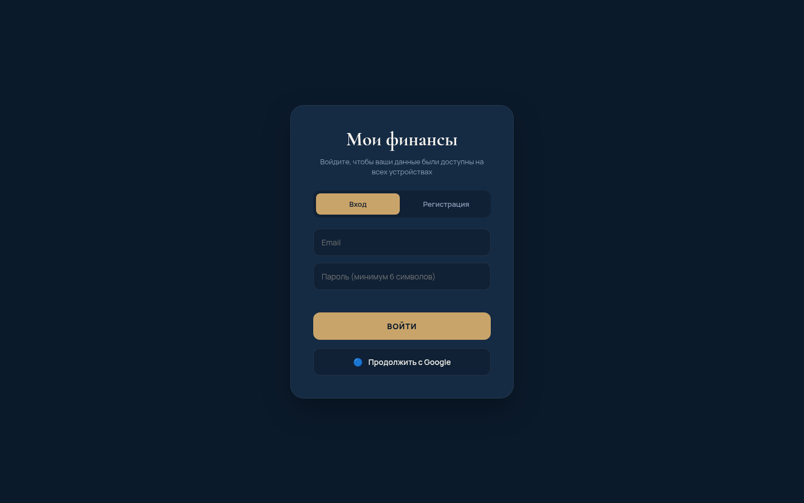
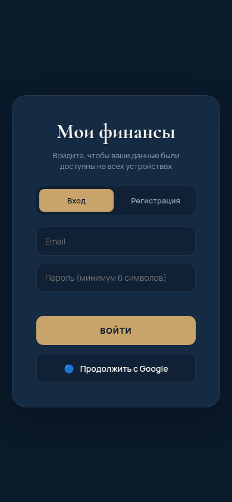

# 💰 Мои финансы Premium

## Демо

**[Открыть сайт →](https://shalim-andrej.github.io/finance-tracker-premium)**

Веб-приложение для учёта личных доходов и расходов с облачной синхронизацией, интерактивными графиками и поддержкой PWA.

🔗 **Живое демо:** [https://shalim-andrej.github.io/finance-tracker-premium/](https://shalim-andrej.github.io/finance-tracker-premium/)

## ✨ Возможности
- 🔐 Аутентификация (Email/Password, Google).
- ☁️ Облачная синхронизация (Firebase Firestore).
- 📊 Аналитика: графики по категориям, дням, топ трат.
- 🎯 Бюджетирование и мультивалютность.
- 📱 PWA (установка на телефон).

## 🛠️ Стек технологий
HTML5, CSS3, JavaScript (ES6+), Firebase, Chart.js.
